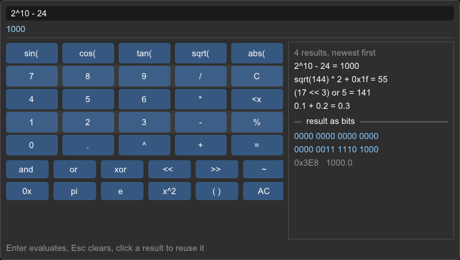
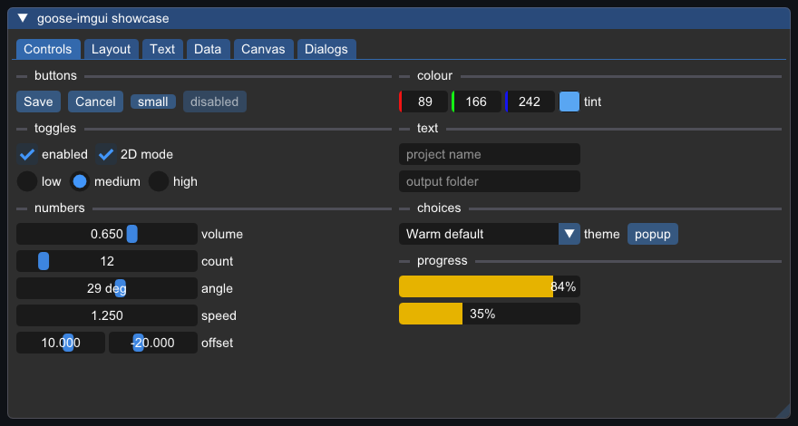
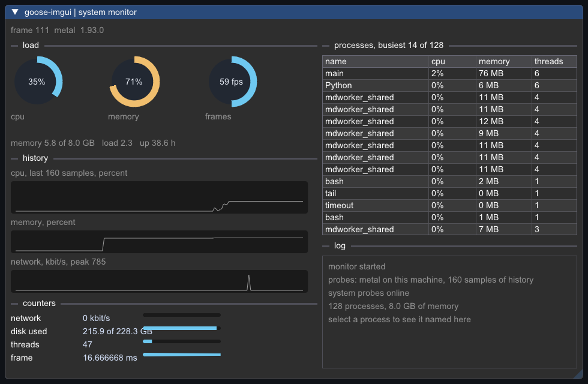
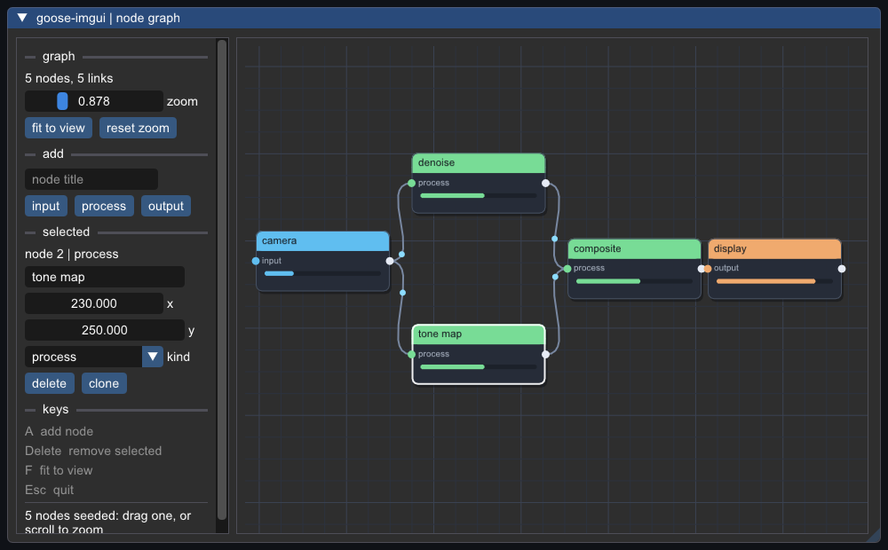
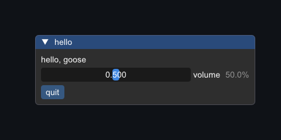

# goose-imgui

[](LICENSE)
[](https://github.com/ocornut/imgui)
[](https://github.com/libsdl-org/SDL)
[](#platform-notes)

Dear ImGui for the [Goose](https://github.com/treeform/goose) language: immediate-mode
GUI on SDL3 and **SDL_GPU**, with no CMake to run and no code to generate by hand.

Import it straight from the repository — the compiler fetches it at that ref, builds its
C with CMake and caches both:

```goose
import imgui from "https://github.com/haseeb-heaven/goose-imgui@develop";

fn main() {
    if !imgui::init("hello", 480, 240) { return; }
    defer imgui::shutdown();

    var volume = 0.5;
    while imgui::frame() {
        imgui::window("hello", imgui::ALWAYS_AUTO_RESIZE) {
            imgui::text("hello, goose");
            if imgui::slider("volume", volume, 0.0, 1.0) {}
            if imgui::button("quit") { imgui::quit(); }
        }
        imgui::end_frame();
    }
}
```

```
goose build hello.goose && ./hello
```

That is the whole setup: `goose build` fetches the package, configures and builds the
native half with CMake for you (via the package's `imgui.build` sidecar), links SDL3, Dear
ImGui and the shim, and runs.

`@develop` follows the branch the work happens on; `@master` is the stable line, and a tag
or a commit pins a build that does not move under you:

```goose
import imgui from "https://github.com/haseeb-heaven/goose-imgui@master";   // stable
import imgui from "https://github.com/haseeb-heaven/goose-imgui@v1.0.0";  // pinned
```

Working on the binding itself, clone the repository and import the directory — nothing is
copied, so edits take effect on the next build:

```sh
git clone https://github.com/haseeb-heaven/goose-imgui
```

```goose
import imgui from "goose-imgui";        // a directory, used in place
```

| | |
|---|---|
|  |  |
| **calculator** — expression evaluator, keypad, history tape, programmer bit view | **showcase** — controls, layout, text, data, canvas and dialogs |
|  |  |
| **system monitor** — this machine's real CPU, memory, network and processes | **node graph** — zoomable canvas, node dragging, bezier links with pulses |

Every screenshot above is the program's own output: each example renders offscreen, runs
thirty frames and writes the frame it just drew as a PNG with `imgui::screenshot`. The
system monitor is showing the machine that took the picture, not sample data — CPU load,
memory, network rate, free disk, load average and the process table all come from
`getloadavg`/mach/`sysctl`/`libproc` on macOS and `/proc` on Linux, through the example's
own `sysinfo.c` (compiled with it by `main.build`).

The smallest one is worth reading first — `examples/hello`, the quickstart above with the
shared argument parsing, thirty lines in total:



## What you get

* **Dear ImGui 1.93.0 (docking branch)**, through the generated C API
  ([dear_bindings](https://github.com/dearimgui/dear_bindings) 0.28) — 698 raw functions
  and 762 constants in `raw.goose`, all of the C API that makes sense from Goose.
* **A typed Goose API** (`imgui.goose`): 208 functions with `f64`/`i64` widgets instead of
  `float`/`int` pointers, `const u8[:]` strings, `bool` returns, and block-scoped
  `window`, `child`, `table` and `menu` closures.
* **SDL3 + SDL_GPU** rendering: Metal on macOS, Vulkan on Linux, D3D12 on Windows. No
  OpenGL, no per-platform backend choice in user code.
* **Offscreen rendering and PNG capture**, so a GUI can be built, tested and screenshotted
  in CI without a display or a window manager.
* **Docking and multi-viewport** support, plus the DockBuilder for fixed layouts.
* **A real font pipeline**: a system font when one is found, `IGS_FONT` to name one, a
  built-in bitmap fallback when none is, and `IGS_FONT_BUILTIN=1` to force it.
* **`goose test`-style self-checks**: 77 checks over buffers, colours, frames, draw data,
  PNG output, fonts, widgets, block-scoped windows, packed struct fields and restart.

## Requirements

| | |
|---|---|
| Goose | a build with `imgui.build` sidecar support (this repository's compiler) |
| C/C++ | a C++17 compiler — Apple clang, clang, gcc 11+, MSVC 2019+ |
| CMake | 3.20 or newer, plus Ninja or Make |
| SDL3 | 3.2 or newer, with SDL_GPU |

SDL3 is found through its CMake package (Homebrew, vcpkg, a distro package), then
pkg-config, then a source tree named by `-DIMGUI_GOOSE_SDL3_SOURCE=/path/to/SDL`.

```sh
brew install sdl3 cmake ninja          # macOS
sudo apt install libsdl3-dev cmake     # Debian/Ubuntu
vcpkg install sdl3                     # Windows
```

## The API in one page

```goose
// lifecycle
imgui::init("title", 1280, 720)          imgui::init_offscreen(1280, 720)
imgui::attach(window, device)            imgui::shutdown()
imgui::frame()                           imgui::end_frame()    imgui::quit()

// frames and windows
imgui::window("name", imgui::NO_TITLE_BAR) { ... }
imgui::begin_window("name") / imgui::end_window()
imgui::child("id", 320.0, 200.0, imgui::BORDERS) { ... }
imgui::table("id", 4, imgui::TABLE_BORDERS | imgui::TABLE_ROW_BG) { ... }

// text, layout, buttons
imgui::text("hi")                        imgui::text_colored(r, g, b, a, "hi")
imgui::text_wrapped("long ...")          imgui::separator_text("section")
imgui::same_line()                       imgui::same_line(120.0)
imgui::button("press")                   imgui::button("press", 120.0, 32.0)
imgui::checkbox("on", flag)              imgui::radio_button("a", choice, 0)

// numbers: f64 and i64, no casts through a pointer
imgui::slider("volume", value, 0.0, 1.0)
imgui::slider("count", count, 0, 100)
imgui::slider_n("offset", values[0], 2, -50.0, 50.0)
imgui::drag("speed", speed, 0.01)        imgui::input("value", value, 0.1, 1.0)
imgui::color_edit("tint", rgb[0], 3)     imgui::progress(0.4, 200.0, 0.0, "40%")

// text input, combos, trees, tabs, popups
imgui::input_text("##name", buffer, imgui::INPUT_ENTER_RETURNS_TRUE)
imgui::input_text_with_hint("##path", "output folder", path, 0)
imgui::combo("theme", index, ["dark", "light"])
imgui::combo_z("theme", index, "dark\0light\0")     // no temporary array
imgui::tree_node("scene") { ... }        imgui::begin_tab_bar("tabs") / end_tab_bar()
imgui::open_popup("id")                  imgui::begin_popup_modal("dialog")

// canvases: the window's draw list
let list = imgui::window_draw_list()
imgui::draw_rect(list, x0, y0, x1, y1, imgui::rgba(70, 120, 180, 255), 6.0, 2.0)
imgui::draw_curve(list, ...)             imgui::draw_text_sized(list, x, y, 11.0, colour, "hi")
imgui::plot_lines("signal", samples, 0.0, 1.0, 400.0, 80.0)

// input state
imgui::mouse_pos()                       imgui::mouse_delta()   imgui::mouse_wheel()
imgui::mouse_down(raw::mouse_button_left) imgui::key_pressed(raw::key_enter)

// textures, screenshots, docking
imgui::texture(w, h, rgba)               imgui::image(tex, 64.0, 64.0)
imgui::screenshot("frame.png")           imgui::dockspace_over_viewport()
```

Everything the typed layer does not cover is in `raw.goose` as `raw::igs_…`, a
one-to-one mapping onto the C API, and `raw::` also carries the constants
(`raw::window_flags_no_title_bar`, `raw::key_f1`, `raw::col_text`, …).

## Layout of this package

```
imgui.goose              the typed API: lifecycle, frames, windows, widgets, canvas
raw.goose                generated extern fns and constants (do not edit)
src/widgets.goose        composite helpers built on the typed API (import imgui.src.widgets)
native/cimgui/           vendored Dear ImGui, dear_bindings output and metadata
native/goose_imgui_shim.{h,cpp}   the hand-written C ABI: values, buffers, PNG, fonts
native/goose_imgui_internal.{h,cpp}  the docking builder, style and DPI bits
native/generated/        per-function C wrappers generated from the metadata
scripts/generate_bindings.py      regenerates raw.goose and native/generated/
scripts/screenshots.sh            builds the examples and captures screenshots/
examples/support/support.goose    the CLI and screenshot plumbing every example shares
examples/{calculator,showcase,system_monitor,node_graph}/   runnable programs
examples/system_monitor/{main.build,sysinfo.c}   that program's own C: the OS probes
tests/test_imgui.goose   77 checks, offscreen, no display needed
```

Every runnable program in this repository lives in `examples/`, one directory per program
with its `main.goose`, and the `support` module they share beside them. Build one straight
from the repository root:

```sh
goose build examples/showcase/main.goose && ./examples/showcase/main
goose build examples/node_graph/main.goose && ./examples/node_graph/main
```

Each accepts `--size WxH`, `--frames N`, `--shot out.png` and `--headless`, so the same
binary can open a window or render a deterministic frame for a screenshot.

A package's root file has to sit beside its siblings, so the typed API is `imgui.goose`
at the package root rather than `src/imgui.goose`: Goose resolves `import imgui.raw`
from `imgui.goose`, and a package root must contain `<name>.goose`. `src/widgets.goose`
is a plain sibling module and is imported as `imgui.src.widgets`.

## Tests

```sh
goose run tests/test_imgui.goose        # in-process (JIT)
goose build tests/test_imgui.goose && ./tests/test_imgui   # native binary
sh scripts/run_tests.sh                 # both, plus the binding check
```

The checks render offscreen through SDL_GPU, so they need a GPU but no display, and they
exit non-zero on failure.

## Regenerating the bindings

```sh
python3 scripts/generate_bindings.py           # rewrite raw.goose and native/generated/
python3 scripts/generate_bindings.py --check   # fail if they are out of date
```

The generator reads `native/cimgui/metadata/dcimgui.json` (and the two backend
descriptors) for the C API, and the `// goose:` lines above the declarations in
`native/goose_imgui_shim.h` and `native/goose_imgui_internal.h` for the hand-written
half. A C signature is therefore written down once, where Goose can see it next to it.

## Platform notes

* **macOS** — Metal through SDL_GPU. A high density display renders at pixel resolution:
  `display_width()` is the size in points, which is what windows are laid out in.
* **Linux** — Vulkan through SDL_GPU; `SDL_GPU` may fall back to `vulkan` software
  rendering in a VM, which is slow but works.
* **Windows** — D3D12 through SDL_GPU; link with `sdl3.lib` from vcpkg or the SDL3 release.
* **Offscreen** — no window, no display, no input: `init_offscreen(w, h)` and
  `screenshot(path)` give a deterministic image for a test or a README.

## Credits

Dear ImGui by Omar Cornut and contributors; dear_bindings by David Jefferson; SDL3 by
Sam Lantinga and contributors. This package's own code is MIT licensed — see
[LICENSE](LICENSE), which also lists the vendored licences.

[Docs/GUIDE.md](docs/GUIDE.md) goes deeper: the ABI rules this binding is built on, how
to add a wrapper, how docking and viewports work, and where the sharp edges are.
